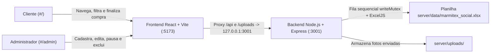
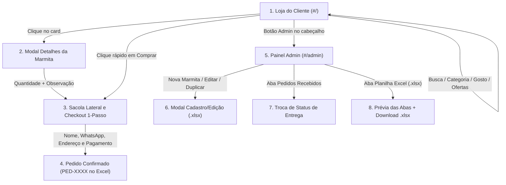

# Prototipagem e Passo a Passo de Uso — MarmitexSocial

Este documento reúne a **prototipagem visual e funcional** do **MarmitexSocial** (acompanhada do protótipo interativo em [`docs/prototipo.html`](prototipo.html)) e o **passo a passo completo** para operar o sistema como **Cliente**, como **Administrador** e diretamente pela **planilha Excel (`marmitex_social.xlsx`)**.

---

## Parte 1 — Prototipagem do Projeto

### 1.1 Arquitetura e Fluxo de Dados



### 1.2 Mapa de Navegação e Jornada do Usuário



### 1.3 Arquitetura de Componentes (Frontend)

| Módulo | Arquivo | Responsabilidade no Protótipo |
| :--- | :--- | :--- |
| Cabeçalho global | `client/src/components/Header.jsx` | Alterna entre `Cardápio` (`#/`) e `Admin` (`#/admin`), mostra tempo estimado (`25-35 min`) e botão de `Sacola` / `Fechar Pedido` |
| Banner principal | `client/src/components/customer/HeroBanner.jsx` | Destaca a proposta de valor e promove 1 prato em destaque com botão `+ Comprar` |
| Barra de filtros | `client/src/components/customer/FilterBar.jsx` | Busca textual, filtro `Ofertas do Dia`, pílulas de categoria e chips de gosto |
| Card de produto | `client/src/components/customer/MarmitaCard.jsx` | Foto, selos (`-XX% OFF`, `Mais Pedida`), porção, calorias, preço riscado/atual e botão verde `Comprar` (ou contador `- Qtd +`) |
| Detalhes do prato | `client/src/components/customer/MarmitaModal.jsx` | Exibe descrição completa, calorias, peso, campo de observação opcional e quantidade |
| Sacola & Checkout | `client/src/components/customer/CartDrawer.jsx` | Lista itens da sacola, coleta dados de entrega em 1 etapa e confirma pedido na planilha |
| Painel Admin | `client/src/components/admin/AdminDashboard.jsx` | KPIs, tabela CRUD de marmitas (editar, duplicar, pausar, destacar, excluir) e abas de pedidos/Excel |
| Formulário CRUD | `client/src/components/admin/MarmitaFormModal.jsx` | Cria e edita marmitas com upload de imagem, URL ou galeria pronta |
| Pedidos Admin | `client/src/components/admin/OrdersTab.jsx` | Lista pedidos salvos no Excel e altera o status da entrega |
| Inspetor Excel | `client/src/components/admin/ExcelPreviewTab.jsx` | Mostra caminho do arquivo, abas `Marmitas`/`Pedidos`, botão `Ler da Planilha` e `Baixar .xlsx` |

### 1.4 Wireframes das Telas Principais

#### Tela 1 — Visão do Cliente (`#/`)
```text
+-------------------------------------------------------------------------+
| [Logo] MarmitexSocial (25-35 min)        [Cardápio | Admin] [Sacola R$] |
+-------------------------------------------------------------------------+
| BANNER LARANJA (#EA580C -> #F59E0B)                                     |
| "Marmitas irresistíveis para todos os gostos"  | [Destaque do Chef]     |
| [Ver Cardápio e Pedir (Verde #16A34A)]          | R$ 26,90 [+ Comprar]  |
+-------------------------------------------------------------------------+
| [Buscar prato, ingrediente ou gosto...]              [Ofertas do Dia]   |
| Categorias: (Todas) (Tradicional) (Fitness) (Vegana) (Gourmet) (Massas) |
| Gosto: [Todos] [Caseiro] [Leve] [Picante] [Rico em Proteína] ...        |
+-------------------------------------------------------------------------+
| +-------------------+ +-------------------+ +-------------------+       |
| | [Foto] -19% | 550g| | [Foto] Mais Pedida| | [Foto] Gourmet    |       |
| | Feijoada Completa | | Frango Fitness    | | Salmão Maracujá   |       |
| | R$ 26,90 [Comprar]| | R$ 23,90 [Comprar]| | R$ 39,90 [Comprar]|       |
| +-------------------+ +-------------------+ +-------------------+       |
+-------------------------------------------------------------------------+
| (Barra Flutuante Fixa quando há itens): [2] Finalizar Pedido • R$ 50,80 |
+-------------------------------------------------------------------------+
```

#### Tela 2 — Modal de Detalhes do Prato + Tela 3 — Sacola Lateral
```text
+------------------------------------+   +--------------------------------+
| [Foto do Prato]                [X] |   | Sua Sacola                 [X] |
| [Categoria] [Tags de Gosto]        |   |--------------------------------|
| Nome da Marmita                    |   | 1x Feijoada Completa  R$ 26,90 |
| Descrição detalhada...             |   |    [-] 1 [+]         [Excluir] |
| [500g]  [25-35 min]  [540 kcal]    |   |--------------------------------|
| Observação: [Sem cebola...       ] |   | Nome: [______________________] |
| [- 1 +] [Adicionar • R$ 26,90    ] |   | WhatsApp: [__________________] |
+------------------------------------+   | Endereço: [__________________] |
                                         | Pagamento: [Pix v]  Obs: [___] |
                                         | [Confirmar Compra • R$ 26,90  ] |
                                         +--------------------------------+
```

#### Tela 4 — Visão do Administrador (`#/admin`)
```text
+-------------------------------------------------------------------------+
| Painel do Administrador        [Baixar Excel (.xlsx)]  [+ Nova Marmita] |
+-------------------------------------------------------------------------+
| [Total Marmitas]   [Ativas no Cardápio]   [Pedidos]   [Vendas Excel]    |
+-------------------------------------------------------------------------+
| Abas: [Gerenciar Marmitas] | [Pedidos Recebidos] | [Planilha Excel]     |
+-------------------------------------------------------------------------+
| [Filtrar por código, nome ou gosto...]          [Categoria: Todas v]    |
|-------------------------------------------------------------------------|
| Prato                  | Categoria & Gosto | Preço    | Status | Ações  |
| MARM-101 Feijoada...   | Tradicional       | R$ 26,90 | Ativa  | Ed|Dp|X|
| MARM-102 Frango Fit... | Fitness           | R$ 23,90 | Ativa  | Ed|Dp|X|
+-------------------------------------------------------------------------+
```

### 1.5 Sistema de Cores Orientado à Leitura e Conversão

| Função Visual | Cor | Aplicação e Objetivo |
| :--- | :--- | :--- |
| Fundo de leitura | Creme `#FFFBF5` e Branco `#FFFFFF` | Reduz cansaço visual e destaca as cores naturais dos alimentos |
| Texto principal | Carvão `#1C1917` e `#57534E` | Alto contraste para leitura rápida de pratos, ingredientes e preços |
| Estímulo de apetite | Laranja `#EA580C` e Âmbar `#F59E0B` | Banner, categorias selecionadas, selo `Mais Pedida` e descontos |
| Ação de compra (CTA) | Verde Esmeralda `#16A34A` | Botões `Comprar`, `Fechar Pedido`, barra flutuante e `Confirmar Compra` |

### 1.6 Esquema da Planilha Excel (`server/data/marmitex_social.xlsx`)

#### Aba `Marmitas`
| Coluna | Tipo / Exemplo | Observação |
| :--- | :--- | :--- |
| `id` | Texto (`MARM-101`) | Gerado automaticamente em sequência |
| `nome` | Texto | Nome exibido no cardápio e no checkout |
| `descricao` | Texto | Ingredientes e acompanhamentos |
| `categoria` | Texto | `Tradicional`, `Fitness & Low Carb`, `Vegetariana & Vegana`, `Executiva`, `Gourmet` ou `Massas` |
| `gosto` | Texto | Tags separadas por vírgula (ex.: `Caseiro, Bem Temperado`) |
| `preco` | Número (BRL) | Preço base obrigatório (> 0) |
| `precoPromocional` | Número ou vazio | Deve ser menor que `preco` quando preenchido |
| `tamanho` | Texto (`500g`) | Peso ou porção exibida no card |
| `calorias` | Número ou vazio | Valor em kcal |
| `tempoPreparo` | Texto (`25-35 min`) | Estimativa exibida no card |
| `imagem` | URL ou caminho local | Caminho em `/images/marmitas/...`, `/uploads/...` ou URL externa |
| `disponivel` | Booleano (`TRUE`/`FALSE`) | Controla exibição na loja (`Sim`/`Não` também aceito em edição manual) |
| `destaque` | Booleano (`TRUE`/`FALSE`) | Prioriza no banner e adiciona selo `Mais Pedida` |
| `criadoEm` / `atualizadoEm` | ISO DateTime | Timestamps de criação e última alteração |

#### Aba `Pedidos`
| Coluna | Conteúdo |
| :--- | :--- |
| `id` | Código sequencial (`PED-1001`, `PED-1002`...) |
| `clienteNome`, `clienteTelefone`, `endereco` | Dados de entrega preenchidos no checkout |
| `formaPagamento` | `Pix`, `Cartão na Entrega`, `Vale-Refeição` ou `Dinheiro` |
| `observacoes` | Observações gerais da entrega |
| `itensResumo` / `itensJson` | Resumo legível e JSON completo com quantidades e preços unitários |
| `total` | Total calculado pelo backend com base nos preços vigentes na aba `Marmitas` |
| `status` | `Recebido`, `Em Preparo`, `Saiu para Entrega`, `Entregue` ou `Cancelado` |
| `criadoEm` | Data/hora do pedido |

---

## Parte 2 — Passo a Passo de Como Usar a Ferramenta

### Passo 1 — Iniciar a Ferramenta

1. Abra um terminal na pasta `C:\Privado\Projetos\MarmitexSocial`.
2. Para iniciar **API + Frontend juntos**, execute:
   ```bash
   npm run dev
   ```
   *(Se preferir terminais separados: rode `npm run dev:server` em um terminal para a API na porta `3001`, e `npm run dev:client` em outro para o Front na porta `5173`.)*
3. Abra no navegador:
   - **Visão do Cliente:** `http://localhost:5173/#/`
   - **Visão do Administrador:** `http://localhost:5173/#/admin`

> **Dica:** Você também pode explorar as telas sem rodar o servidor abrindo o protótipo clicável [`docs/prototipo.html`](prototipo.html) direto no navegador.

---

### Passo 2 — Comprar na Visão do Cliente (`#/`)

1. **Encontrar a marmita ideal**:
   - Digite no campo de busca um prato, ingrediente ou sabor (ex.: `feijoada`, `salmão`, `picante`).
   - Clique nas pílulas de **Categoria** (`Tradicional`, `Fitness & Low Carb`, `Vegetariana & Vegana`, `Executiva`, `Gourmet`, `Massas`) ou nos filtros de **Gosto** (`Caseiro`, `Leve`, `Rico em Proteína`, etc.).
   - Ative **Ofertas do Dia** para listar somente os pratos com preço promocional.
2. **Adicionar à sacola**:
   - Para compra imediata, clique no botão verde **Comprar** do card. Depois de adicionar, use os botões `-` e `+` no próprio card para ajustar a quantidade.
   - Para ver detalhes completos e inserir uma observação (ex.: *"sem cebola"*, *"molho à parte"*), clique na foto ou no título do prato, ajuste a quantidade e clique em **Adicionar**.
3. **Finalizar o pedido em 1 etapa**:
   - Clique em **Fechar Pedido** no cabeçalho (ou na barra verde fixa no rodapé **Finalizar Pedido Agora**).
   - Na sacola lateral, revise os itens e preencha:
     - **Seu nome completo**
     - **WhatsApp ou telefone**
     - **Endereço completo**
     - **Forma de pagamento** (`Pix`, `Cartão na Entrega`, `Vale-Refeição` ou `Dinheiro`)
     - **Observação da entrega** (opcional)
   - Clique em **Confirmar Compra**. O pedido recebe um código (`PED-XXXX`) e é salvo na hora na aba `Pedidos` da planilha Excel.

---

### Passo 3 — Cadastrar, Editar e Excluir Marmitas no Admin (`#/admin`)

1. No topo do site, clique em **Admin** (ou acesse `http://localhost:5173/#/admin`).
2. **Cadastrar nova marmita**:
   - Clique no botão laranja **+ Nova Marmita**.
   - Preencha **Nome da Marmita**, **Categoria**, **Descrição do Prato e Acompanhamentos** e **Gosto / Perfil de Sabor** (clique nas tags prontas ou digite tags separadas por vírgula).
   - Informe **Preço (R$)** e, se houver promoção, **Preço Promo (R$)** (menor que o preço normal).
   - Defina **Porção / Peso**, **Calorias** e **Tempo de Preparo**.
   - Escolha a foto de três formas: colando uma URL, clicando em **Upload** (arquivo PNG/JPG/WEBP até 5 MB salvo em `server/uploads/`) ou selecionando uma foto da galeria pronta.
   - Deixe **Disponível para venda** marcado para exibir no cardápio e marque **Destaque / Mais Pedida** se quiser promovê-la.
   - Clique em **Cadastrar Marmita**.
3. **Editar informações e editar marmitas**:
   - Na tabela **Gerenciar Marmitas**, clique em **Editar** na linha do prato para alterar qualquer campo e clique em **Salvar Alterações**.
   - Para edições rápidas na própria tabela:
     - Clique no botão **Disponível** / **Pausada** para ocultar ou reativar a marmita na loja.
     - Clique em **★ Remover destaque** / **☆ Marcar destaque** para alternar o selo de destaque.
     - Clique no ícone **Duplicar** para criar rapidamente uma variação (por exemplo, tamanho P ou G de um prato existente).
4. **Deletar uma marmita**:
   - Clique no ícone de lixeira (**Excluir**) na linha da marmita e confirme em **Sim, Excluir**. A linha é removida imediatamente da planilha `.xlsx`.

---

### Passo 4 — Acompanhar Pedidos e Trabalhar com a Planilha Excel

1. **Atualizar status dos pedidos**:
   - No painel Admin, clique na aba **Pedidos Recebidos**.
   - Use o seletor de cada pedido para mudar o status (`Recebido` → `Em Preparo` → `Saiu para Entrega` → `Entregue` ou `Cancelado`). A alteração grava direto no Excel.
2. **Inspecionar e baixar a planilha `.xlsx`**:
   - Clique na aba **Planilha Excel (.xlsx)** para visualizar os dados tabulares das abas `Marmitas` e `Pedidos`.
   - Clique em **Baixar .xlsx** para fazer download de uma cópia atualizada.
3. **Editar o arquivo manualmente no Microsoft Excel**:
   - O arquivo oficial fica em `C:\Privado\Projetos\MarmitexSocial\server\data\marmitex_social.xlsx`.
   - Se abrir o arquivo no Excel para editar valores manualmente, **salve e feche o Excel antes de criar, editar ou excluir registros pelo site** (evitando bloqueio de arquivo no Windows).
   - Depois de fechar o Excel, clique em **Ler da Planilha** no painel Admin (ou recarregue a página) para sincronizar suas edições manuais.
